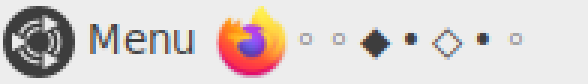
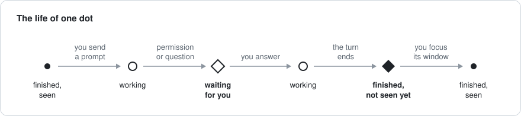
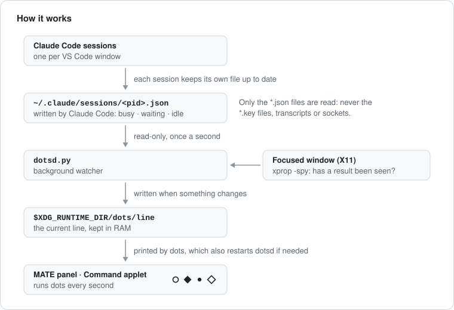

# claude-dots

**A discreet status light for your Claude Code sessions: in the MATE panel on Linux, or as a tiny strip on the Windows taskbar.**

Run Claude Code in several VS Code windows and you end up flipping between them to see which one is done. claude-dots shows one tiny dot per project. At a glance you know which sessions are still working, which one just finished, and which one is stuck waiting for you. Anyone else just sees a few dots.

<p align="center">
  
</p>
<p align="center"><sub>Linux, MATE panel, zoomed 3×. Actual size: </sub></p>

## What the dots mean

| Dot | Meaning |
| :-: | --- |
| ◦ | **working**: Claude is busy on a turn |
| ◇ | **waiting for you**: a permission prompt or a question is open |
| ◆ | **finished, not seen yet**: the turn ended since you last looked at that window |
| • | **finished, seen**: nothing new |
| ? | **unknown**: the registry format changed (see [Limitations](#limitations)) |

A ◆ turns into • as soon as you focus that project's VS Code window.

<p align="center">
  
</p>

A dot keeps its place: the order is recorded on the first run (on Linux, the order of your VS Code windows in the taskbar; on Windows, the order the sessions started) and new projects are added at the end. A folder with several sessions shows its most urgent state.

## Linux (MATE panel)

**Requirements:** the MATE panel on X11 (tested on Linux Mint 21.1, MATE 1.26), `/usr/bin/python3` 3.7+, `xprop` (package `x11-utils`), `dconf` (package `dconf-cli`) and `setsid` (util-linux).

```sh
git clone https://github.com/medalimoussa/claude-dots.git
cd claude-dots/linux
./install.sh
```

`install.sh` copies two files to `~/.local/share/dots`, saves your current panel settings next to them (`panel-backup.dconf`), and adds a MATE *Command* applet to the top panel, after the items on its left. It changes no Claude Code setting and adds no hook. Run it again to update. To put the dots somewhere else, set `DOTS_PANEL` (panel ids: `dconf read /org/mate/panel/general/toplevel-id-list`) or `DOTS_POSITION` (in pixels), for example `DOTS_PANEL=bottom ./install.sh`.

**Which dot is which?**

```console
$ ~/.local/share/dots/dotsd.py --legend
1  ◦  api-server                          working
2  ◆  website                             finished, not seen yet
3  •  thesis                              finished, seen

◇ waiting for you   ◆ finished, not seen yet   ◦ working   ? unknown status   • finished, seen
```

Reorder the dots by editing `~/.local/share/dots/order` (one project folder per line). Uninstall with `./uninstall.sh`: it removes the applet, stops the watcher and deletes `~/.local/share/dots`.

## Windows (experimental)

> **Not yet tested on a real Windows machine.** `windows/dots.pyw` was written against Claude Code's Linux build, and its logic is tested on Linux with the Windows calls stubbed. If it misbehaves, please open an issue.

**Requirements:** Windows 10 or 11, Python 3.8+ from [python.org](https://www.python.org/downloads/windows/) (tkinter is included by default), Claude Code in VS Code. Nothing to `pip install`.

```powershell
git clone https://github.com/medalimoussa/claude-dots.git
py claude-dots\windows\dots.pyw --install
```

The dots appear on the taskbar, just left of the notification area, and start again at every login (Task Manager › Startup apps, as `dots`). Windows has no panel-applet API, so they live in their own tiny always-on-top strip that takes the colour of the taskbar beside it.

- **Move** the strip by dragging it; it remembers the spot.
- **Right-click** it for the legend (which dot is which) or to quit. `py claude-dots\windows\dots.pyw --legend` prints the same thing in a terminal.
- **Reorder** the dots by editing `%LOCALAPPDATA%\dots\order`.
- It runs from the cloned folder: run `--install` again if you move that folder.
- **Uninstall** with `py claude-dots\windows\dots.pyw --uninstall`. It stops the strip and removes its login entry and its data in `%LOCALAPPDATA%\dots`.

## Keep it private

This README is public, so anyone who reads it can decode the default glyphs. They are one line, `GLYPHS`, at the top of `linux/dotsd.py` and of `windows/dots.pyw`. Change it before installing, and your panel speaks your own code again.

## How it works

<p align="center">
  
</p>

- **The data comes from Claude Code itself.** Each running session keeps a small JSON file in `~/.claude/sessions/` (`%USERPROFILE%\.claude\sessions\` on Windows) with its project folder, its `status` (`busy`, `waiting`, `idle`, or `shell`, which is idle with a shell command still running), when that last changed, and its process start time.
- **Read-only.** The watcher reads those `*.json` files once a second. It never writes to them, never opens the `*.key` files, transcripts or sockets next to them, and never talks to a session.
- **No ghosts.** A closed session leaves its file behind, and its PID can be reused by another program. On Linux the watcher checks that the process with that PID started at the recorded time, as Claude Code does. On Windows it compares start times too, and falls back to the program's name when the recorded format isn't one it knows.
- **"Seen" means focused.** The watcher reads the project folder from the title of the focused VS Code window (`file - folder - Visual Studio Code`): through `xprop -spy` on Linux, `GetForegroundWindow` on Windows.
- **Cheap and self-healing, on Linux.** The line lives in `$XDG_RUNTIME_DIR` (RAM). The applet runs `dots` every second: it prints the line and restarts the watcher if needed, in about 1 ms. The applet comes back with the panel at every login, and the watcher exits a few minutes after the applet is removed.
- **One process, on Windows.** `dots.pyw` reads the registry, checks the processes, follows the focused window and draws the strip itself, once a second.

## Limitations

- **Undocumented data.** The session registry is an internal Claude Code file, not a public API. An update can change it, and you would see `?` or no dots. Last checked with Claude Code 2.1.286.
- **VS Code sessions only.** A session started in a terminal didn't appear in the registry in my tests, so it gets no dot. Background infrastructure sessions (`daemon` kinds) are left out on purpose. VS Code forks (Cursor, VSCodium…) are recognized for focus but untested.
- **Focus needs the default VS Code window title**, and X11 on Linux. With a custom `window.title`, a ◆ stays until the session's next turn.
- **One dot per folder**, not per session.
- **Windows is experimental**: see above.

## Other systems

**macOS, GNOME, KDE and Xfce aren't supported yet**, but the idea carries over. Three parts are system-specific:

| Part | Linux (MATE) | Windows | macOS | Other Linux desktops |
| --- | --- | --- | --- | --- |
| Is the session still running? | `/proc/<pid>/stat` | `GetProcessTimes` | to explore | same as MATE |
| Which window has focus? | `xprop -spy` | `GetForegroundWindow` | `NSWorkspace` | same on X11 |
| Display | MATE *Command* applet | always-on-top strip (tkinter) | SwiftBar or xbar plugin | Xfce *Generic Monitor*, KDE *Command Output*, GNOME *Executor* |

Pull requests are welcome.

## License

MIT, see [LICENSE](LICENSE). claude-dots is an unofficial community tool, not affiliated with or endorsed by Anthropic.
